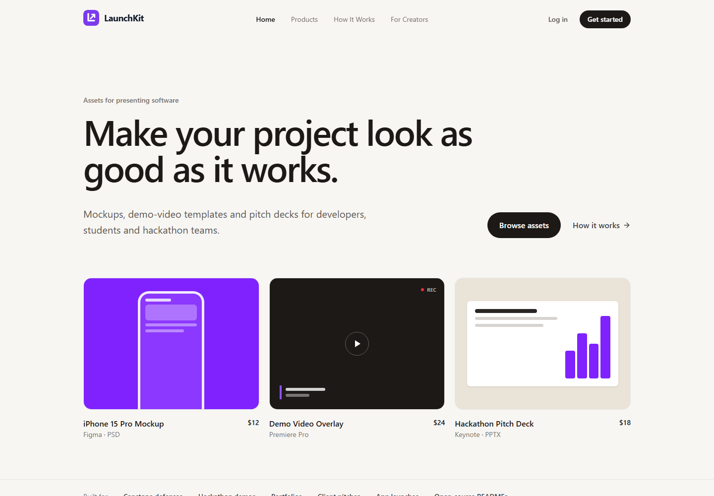
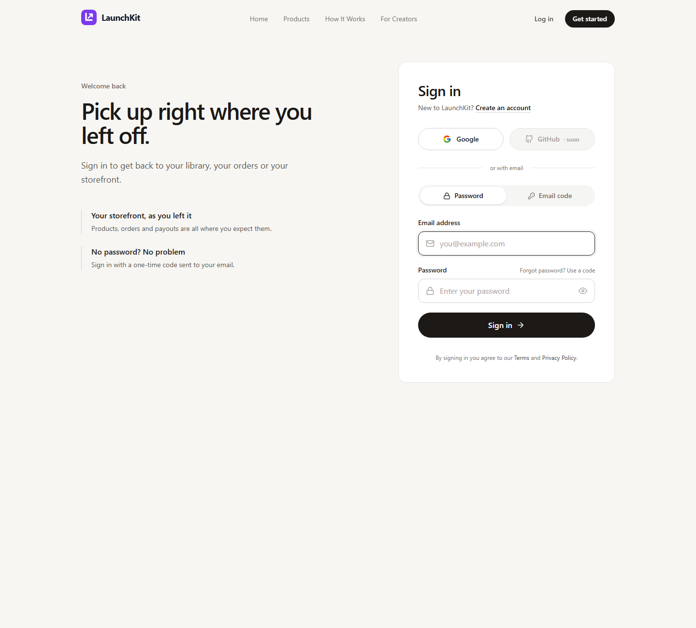
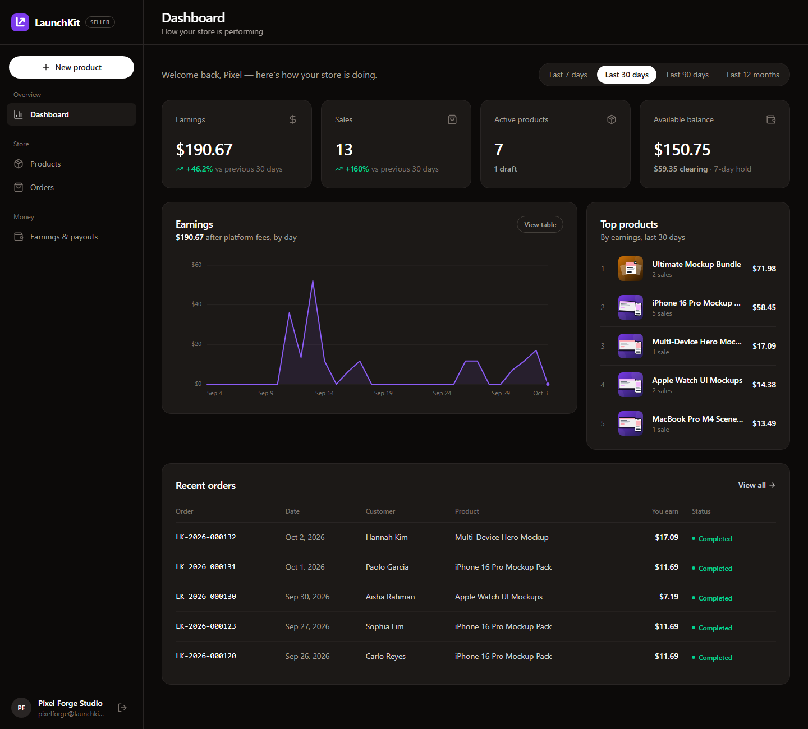

<p align="center">
  
</p>

<h1 align="center">LaunchKit</h1>

<p align="center">
  A marketplace for the assets that make software look finished:<br />
  device mockups, demo-video templates and pitch decks, for developers, students and hackathon teams.
</p>

<p align="center">
  
</p>

---

## Why LaunchKit?

Good software gets overlooked every day because it's presented poorly. Students lose marks in capstone defenses because of amateur slides, hackathon teams have no time to cut a demo video, and indie developers lose clients to unpolished portfolios.

LaunchKit closes that **presentation gap**. It's a multi-vendor marketplace:

- **Customers** browse, buy and instantly download ready-made presentation assets.
- **Sellers** (designers and presentation pros) open a storefront, upload products and get paid when they sell.

## Features

### For customers
- **Storefront** with search, category filters, sorting, trending and new arrivals, and bundle deals
- **Product previews** in a shareable details view (`?product=<id>` in the URL)
- **Cart and checkout** with tax calculated at checkout
- **Order history** with printable receipts
- **Downloads library**: re-download anything you've bought, any time

### For sellers
- **Dashboard** with earnings, sales, active products and available balance, compared against the previous period
- **Earnings chart** (7 days, 30 days, 90 days or 12 months) with a keyboard-accessible tooltip and a table view
- **Product management**: upload the product file plus a preview image, set the price, and keep it as a draft, active or archived
- **Orders** list and **Earnings & payouts**, with a holding period before earnings can be withdrawn and payout requests to GCash, bank or PayPal

### Accounts
- Sign in with **email and password**, a **one-time email code**, or **Google**
- New Google users pick a role (customer or seller) during onboarding
- Customer and seller areas are kept separate: each role can only open its own pages

### Payments
Checkout runs on a built-in **sandbox payment provider** that behaves like a real gateway's test mode. **No real money moves.** The card is turned into a token in the browser and only the token reaches the server, the same model Stripe and PayMongo use. See [Test cards](#test-cards).

## Screenshots

| Sign in | Seller dashboard |
| --- | --- |
|  |  |

## Tech stack

| Part | Built with |
| --- | --- |
| Frontend | React 19, TypeScript, Vite, React Router, Tailwind CSS |
| Backend | Node.js, Express 5, TypeScript |
| Database | MongoDB with Mongoose |
| Auth | JWT, bcrypt password hashing, Passport (Google OAuth 2.0) |
| File uploads | Multer (product files are private and preview images are public) |

## Project structure

```
LaunchKit/
├── client/                 # React frontend (Vite)
│   ├── public/             # Static files (favicon)
│   └── src/
│       ├── api/            # API calls to the server
│       ├── components/     # Shared UI, plus customer/ and seller/ components
│       ├── context/        # Auth, cart and alert state
│       ├── hooks/          # Data-fetching hooks
│       ├── pages/          # Home, login, signup, customer/ and seller/ pages
│       └── utils/          # Money formatting, card helpers, route rules
└── server/                 # Express API
    └── src/
        ├── config/         # Database and Passport (Google) setup
        ├── controllers/    # Request handlers
        ├── middleware/     # Auth guard and file-upload handling
        ├── models/         # User, Product, Cart, Order, Payout, Counter
        ├── routes/         # /api/auth, /products, /cart, /orders, /seller
        ├── scripts/seed.ts # Demo data
        ├── services/       # Payments and purchase ownership
        └── utils/          # Pricing (tax, platform fee, payouts)
```

## Getting started

### Prerequisites
- [Node.js](https://nodejs.org/) 20.19 or newer (Vite 8 requires it)
- [MongoDB](https://www.mongodb.com/), either installed locally or a free [MongoDB Atlas](https://www.mongodb.com/atlas) database

### 1. Clone the repository

```bash
git clone https://github.com/KimArthemSon/LunchKit.git
cd LunchKit
```

### 2. Set up the server

```bash
cd server
npm install
cp .env.example .env
```

Open `server/.env` and set at least `MONGO_URI` and `JWT_SECRET`. The comments in [`.env.example`](server/.env.example) explain every setting.

> **Note:** `GOOGLE_CLIENT_ID` and `GOOGLE_CLIENT_SECRET` can't be empty, or the server won't start. The placeholder values in `.env.example` are fine if you don't need Google sign-in. To enable it, create OAuth credentials in the [Google Cloud Console](https://console.cloud.google.com/apis/credentials) with the redirect URI `http://localhost:5000/api/auth/google/callback`.

Then load the demo data and start the API:

```bash
npm run seed   # optional: demo sellers, customers, products and orders
npm run dev    # API runs at http://localhost:5000
```

### 3. Set up the client

In a second terminal:

```bash
cd client
npm install
npm run dev    # app runs at http://localhost:5173
```

The client calls `http://localhost:5000` by default. To point it at another API, set `VITE_API_URL` in `client/.env.local`.

## Demo accounts

After `npm run seed`, every demo account uses the password **`demo1234`**. Sign in on the **Password** tab.

| Role | Email | Good for |
| --- | --- | --- |
| Seller | `pixelforge@launchkit.demo` | Monthly sales and a draft product |
| Seller | `launchpad@launchkit.demo` | Has never withdrawn, so "Request payout" works |
| Customer | `juan.dela.cruz@launchkit.demo` | Past orders and 2 items in the cart |
| Customer | `maria.santos@launchkit.demo` | Past orders and 2 items in the cart |

The full list is in [`DEMO_ACCOUNTS.txt`](DEMO_ACCOUNTS.txt). To reset the demo data, run `npm run seed` again. To remove it (your own data is kept), run `npm run seed -- --clear`.

### Email codes in development
One-time sign-in codes aren't emailed yet. In development, the code is printed in the **server terminal**.

## Test cards

Checkout uses the sandbox provider, so no real charges are made. Use any future expiry date and any CVC.

| Card number | Result |
| --- | --- |
| `4242 4242 4242 4242` | Payment succeeds |
| `4000 0000 0000 0002` | Card declined |
| `4000 0000 0000 9995` | Insufficient funds |

The checkout page also lists these cards, and clicking one fills it in for you.

## How money works

All amounts are stored in whole cents to avoid rounding errors.

- **Tax**: 8% is added at checkout (`TAX_RATE`).
- **Platform fee**: LaunchKit keeps 10% of each sale and the seller earns the rest (`PLATFORM_FEE_RATE`).
- **Holding period**: a sale's earnings become withdrawable after 7 days (`EARNINGS_HOLD_DAYS`).
- **Minimum payout**: sellers can withdraw once they have at least $10.00 (`MIN_PAYOUT_CENTS`).

All four can be changed in `server/.env`.

## API overview

All endpoints live under `/api`. Routes marked 🔒 need a signed-in user.

| Area | Endpoints |
| --- | --- |
| Auth | `POST /auth/register`, `POST /auth/login`, `POST /auth/request-otp`, `POST /auth/verify-otp`, `GET /auth/google`, `GET /auth/me` 🔒 |
| Products | `GET /products`, `GET /products/feed`, `GET /products/:id`, `GET /products/:id/file` 🔒 (owner or buyer only) |
| Seller products | `GET /products/mine`, `POST /products`, `PUT /products/:id`, `DELETE /products/:id` 🔒 sellers |
| Cart | `GET /cart`, `POST /cart/items`, `DELETE /cart/items/:productId`, `DELETE /cart` 🔒 |
| Orders | `POST /orders/checkout`, `GET /orders`, `GET /orders/:id`, `GET /orders/library` 🔒 |
| Seller | `GET /seller/overview`, `GET /seller/sales`, `GET /seller/earnings`, `PUT /seller/payout-account`, `POST /seller/payouts` 🔒 sellers |

## Scripts

| Folder | Command | What it does |
| --- | --- | --- |
| `server` | `npm run dev` | Start the API and restart it on file changes |
| `server` | `npm run build` / `npm start` | Compile to JavaScript and run the compiled server |
| `server` | `npm run seed` | Reset the demo data (`-- --clear` removes it, `-- --previews` redraws only the cover images) |
| `client` | `npm run dev` | Start the app in development mode |
| `client` | `npm run build` | Type-check and build for production into `client/dist` |
| `client` | `npm run lint` | Run ESLint |

## Roadmap

- Send one-time codes by real email
- Connect a live payment provider (for example Stripe or PayMongo)
- GitHub sign-in (the button is already in the UI, marked "soon")
- Terms of Service and Privacy Policy pages

## Author

Built by [@KimArthemSon](https://github.com/KimArthemSon).
